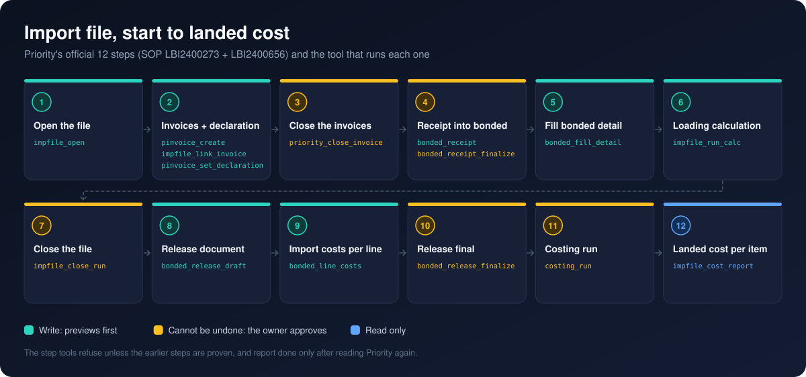

<p align="center">
  
  
  
</p>

<h1 align="center">Priority MCP Server</h1>

<p align="center">
  <strong>Connect AI assistants to Priority ERP</strong><br/>
  126 tools &middot; import files end to end &middot; schema, help and scoped result resources &middot; 5 workflow prompts
</p>

<p align="center">
  <a href="https://opensource.org/licenses/MIT"></a>
  <a href="https://nodejs.org"></a>
  <a href="#tools"></a>
  <a href="#import-files-end-to-end"></a>
  <a href="#mcp-prompts-5"></a>
</p>

<p align="center">
  <a href="#import-files-end-to-end">Import Files</a> &bull;
  <a href="#quick-start">Quick Start</a> &bull;
  <a href="#setup-recipes">Setup Recipes</a> &bull;
  <a href="#configuration">Configuration</a> &bull;
  <a href="#tools">Tools</a> &bull;
  <a href="#deployment">Deployment</a> &bull;
  <a href="#priority-setup">Priority Setup</a>
</p>

---

## What is this?

An open-source **[MCP (Model Context Protocol)](https://modelcontextprotocol.io)** server that wraps **Priority ERP's OData REST API** and exposes it as tools that any MCP-compatible AI assistant can use.

Ask your AI assistant things like:

> *"Show me all customers with overdue invoices over $10,000"*
>
> *"Create a sales order for customer C1001 with 50 units of product X"*
>
> *"Give me a morning briefing: new orders, cash position, and low stock alerts"*
>
> *"Run a debt collection workflow for customer ACME"*
>
> *"Where does import file IM99000001 stand, and what is the next step?"*

Works with **Claude Desktop**, **Claude Code**, **Cursor**, **Windsurf**, and any MCP-compatible client.

---

## Import files, end to end

<p align="center">
  
</p>

<table align="center">
  <tr>
    <td align="center"><strong>32</strong><br/><sub>import-file tools</sub></td>
    <td align="center"><strong>12 of 12</strong><br/><sub>official steps have a tool</sub></td>
    <td align="center"><strong>6</strong><br/><sub>step tools piloted on a real file</sub></td>
    <td align="center"><strong>4</strong><br/><sub>irreversible steps behind an approval code</sub></td>
  </tr>
</table>

The server runs a whole import file (תיק יבוא) in Priority's own order, as written in its two
SOPs: import files (LBI2400273) and the bonded warehouse (LBI2400656). It goes from opening the
file, through the bonded warehouse, to the landed cost of every product. Ask for it in plain
language:

> *"Where does import file IM99000001 stand, and what is the next step?"*
>
> *"Receive the goods invoice of IM99000001 into the bonded warehouse. Show me the preview first."*
>
> *"Is the company ready for a costing run?"*
>
> *"What did each product in IM99000001 cost us, landed?"*

### Step by step

| # | Step | Tool | Priority program | Type | Pilot |
|:-:|:-----|:-----|:-----------------|:-----|:----------------:|
| 1 | Open the file | `impfile_open` | | Write | |
| 2 | Link the invoices, declaration on every goods line | `pinvoice_create` · `impfile_link_invoice` · `pinvoice_set_declaration` | | Write | ✅ ¹ |
| 3 | Close the invoices | `priority_close_invoice` | סגירת חשבונית (`CLOSEANINVOICE`) | **Final**, owner approves | |
| 4 | Receipt into the bonded warehouse | `bonded_receipt` | | Draft | ✅ |
| 4b | Receipt final | `bonded_receipt_finalize` | | **Final**, approval code | Not yet |
| 5 | Fill the bonded detail | `bonded_fill_detail` | מילוי פירוט למחסן ערובה (`FILL_IMPFILES`) | Program | ✅ ² |
| 6 | Loading calculation | `impfile_run_calc` | חישוב העמסה (`IMPFILE2`) | Program | ✅ |
| 7 | Close the file | `impfile_close_run` | סגירת התיק (`IMPFILE1`) | **Final**, approval code | Not yet |
| 8 | Release document (draft) | `bonded_release_draft` | | Draft | ✅ |
| 9 | Import costs per line | `bonded_line_costs` | רישום עלויות יבוא לשורה (`IMPORTCOSTPERLINE`) | Program | ✅ |
| 10 | Release final | `bonded_release_finalize` | | **Final**, approval code | Not yet |
| 11 | Costing, company-wide | `costing_run` | תמחיר לתאריך נוכחי (`FNCCOSTINGPART`) | **Final**, approval code | Not yet |
| 12 | Landed cost per product | `impfile_cost_report` | | Read | |

<sub>Write, Draft and Program steps preview first and can be corrected. **Final** steps cannot be
undone. ¹ The pilot covers `pinvoice_set_declaration`. ² Piloted when the tool zeroed the VAT line; it
now deletes that line, and the delete has not run live yet. An empty cell means the tool is not
part of the supervised-pilot list. Every result carries `piloted: true | false`, so an assistant
knows when a first real run needs the owner watching.</sub>

### What keeps it safe

- **Preview first.** Every step defaults to `dryRun: true`: it checks everything, sends nothing,
  and returns what it would do.
- **Order is enforced.** A step refuses unless the earlier steps are proven in Priority. A repeat of
  a finished step changes nothing and answers `already-done`.
- **Done means re-read.** A step reports `done` only after it reads Priority again and finds the
  result. The two final-status steps also check that the stock moved by the right quantities. A run
  it cannot prove is `unverified`, never `done`.
- **Priority's own programs, run once.** Programs start through the Web SDK and are never retried.
  An unexpected question cancels the program; the tool never invents an answer.
- **An empty read is not trusted.** If a form answers with no rows even unfiltered, the step is
  `blocked` instead of creating a duplicate.

> [!IMPORTANT]
> The four steps that cannot be undone (receipt final, file close, release final, costing) need an
> **approval code**. The preview issues it. It is valid for 10 minutes, once, for that tool and that
> document only, and only while the document is still what the preview showed. An assistant passes
> the code only after the owner saw that preview and approved it in chat.

### Reading a file at any moment

| Question | Tool |
|:---------|:-----|
| Which files are open, for which supplier or order? | `impfile_search` |
| What is in this file: invoices, costs, customs estimate, goods, order lines? | `impfile_get` |
| Where does it stand on the 12 steps, and who does the next one? | `impfile_preflight` |
| Does ordered = received = invoiced? | `po_match` |
| Is the company ready for a costing run? | `impfile_costing_readiness` |
| What did each product cost, landed, and does it tie to the cost invoices? | `impfile_cost_report` |

<details>
<summary><strong>Known limits</strong></summary>

- The four approval tools are merged and tested offline, but have not yet passed a supervised run
  on a real file.
- Country of origin is written only where the countries table is open to the API.
- A partial quantity for a part that sits on several release lines is set in the Priority screen.
- A late invoice (reopen the release and recalculate) is not covered.
- A file whose receipt was entered against purchase-order lines shows step 4 as unknown and
  continues in the screen.
- `impfile_close_run` sees only changes made through this server; a change made in the screen
  after the loading calculation is not seen.

Full contract, pilot protocol and checks: [`docs/impfiles-runbook.md`](docs/impfiles-runbook.md).
</details>

---

## Quick Start

### Local Hebrew request portal (Instinct browser demo)

The optional portal uses normal login/forms and a private SQLite database with dummy data.
It prepares invoice-receipt, supplier and purchase-order requests, and shows saved results.
It never connects to Priority/MCP, cannot approve or execute requests, and does not start or
modify a Telegram bot. Node **22.13+** is required for the web portal.

```bash
npm ci
npm run web:setup
npm run web:start
```

Open **http://127.0.0.1:3210**. Setup asks for a site-only agent password in the terminal.
Store it directly in the browser vault, never in chat. Alternatively, use
`npm run web:setup -- --generate` for credentials in a private local file.
The server binds to loopback only. [Hebrew runbook and test-company gaps](docs/web-demo.md).

### MCP server

```bash
# Set your Priority credentials. The service root is assembled as
#   {PRIORITY_API_URL}/{PRIORITY_ENVIRONMENT}/{PRIORITY_COMPANY}
# which for the values below is:
#   https://your-server.com/odata/Priority/tabula.ini/demodata
export PRIORITY_API_URL="https://your-server.com/odata/Priority"
export PRIORITY_ENVIRONMENT="tabula.ini"   # the system .ini segment (almost always tabula.ini)
export PRIORITY_COMPANY="demodata"
export PRIORITY_PAT="your-token"            # preferred token authentication
export PRIORITY_READ_ONLY="true"

# Run it
npx priority-mcp-server
```

The server starts on stdio and is ready for your MCP client. That's it.

> **Not sure of the URL?** Take the exact OData root that works in your browser/curl
> (everything up to but not including the form name, e.g.
> `https://your-server.com/odata/Priority/tabula.ini/demodata`) and put it in a single
> `PRIORITY_SERVICE_ROOT` variable instead — it overrides the three parts above.

---

## Setup Recipes

### Claude Desktop

Add to your config file:
- **macOS:** `~/Library/Application Support/Claude/claude_desktop_config.json`
- **Windows:** `%APPDATA%\Claude\claude_desktop_config.json`

```json
{
  "mcpServers": {
    "priority": {
      "command": "npx",
      "args": ["-y", "priority-mcp-server"],
      "env": {
        "PRIORITY_API_URL": "https://your-server.com/odata/Priority",
        "PRIORITY_ENVIRONMENT": "tabula.ini",
        "PRIORITY_COMPANY": "demodata",
        "PRIORITY_USERNAME": "apiuser",
        "PRIORITY_PASSWORD": "your-password"
      }
    }
  }
}
```

### Claude Code

```bash
claude mcp add priority -s user \
  -e PRIORITY_API_URL="https://your-server.com/odata/Priority" \
  -e PRIORITY_ENVIRONMENT="tabula.ini" \
  -e PRIORITY_COMPANY="demodata" \
  -e PRIORITY_USERNAME="apiuser" \
  -e PRIORITY_PASSWORD="your-password" \
  -e PRIORITY_READ_ONLY="true" \
  -- npx -y priority-mcp-server
```

> Options go **before** the server name, then `--`, then the launch command. Start with
> `PRIORITY_READ_ONLY=true` and set it explicitly to false only when writes are intended. Then run `/mcp`
> (or restart the session) to load the tools. PAT installs: `PRIORITY_USERNAME=<token>`,
> `PRIORITY_PASSWORD=PAT`.

### Cursor

Open **Settings > MCP Servers > Add**, and paste the same JSON config as Claude Desktop above.

### Windsurf

Add to your Windsurf MCP configuration with the same JSON structure as Claude Desktop.

### Docker (Remote / HTTP mode)

```bash
docker run -p 127.0.0.1:3000:3000 \
  -e MCP_HTTP_HOST=0.0.0.0 \
  -e MCP_HTTP_AUTH_TOKEN="$MCP_HTTP_AUTH_TOKEN" \
  -e MCP_TRANSPORT=http \
  -e PRIORITY_API_URL="https://your-server.com/odata/Priority" \
  -e PRIORITY_ENVIRONMENT="tabula.ini" \
  -e PRIORITY_COMPANY="demodata" \
  -e PRIORITY_USERNAME="apiuser" \
  -e PRIORITY_PASSWORD="your-password" \
  priority-mcp-server:0.2.0
```

---

## Configuration

Preferred token variable: `PRIORITY_PAT`. `PRIORITY_BASE_URL` can supply the URL through the `.ini` segment, with `PRIORITY_COMPANY` appended. HTTP defaults: host `127.0.0.1`, 30-minute idle sessions, maximum 100 sessions. Non-loopback binding requires `MCP_HTTP_AUTH_TOKEN`; optional `MCP_HTTP_ALLOWED_ORIGINS` allows specific browser origins. `REQUEST_TIMEOUT_MS` defaults to 120000.

All configuration is via environment variables. Validated on startup — the server fails fast with a clear error if anything is missing.

| Variable | Required | Default | Description |
|:---------|:--------:|:-------:|:------------|
| `PRIORITY_API_URL` | Yes¹ | — | Base up to and including `/odata/Priority` (e.g. `https://srv/odata/Priority`) |
| `PRIORITY_ENVIRONMENT` | No | `tabula.ini` | System `.ini` segment. Append a language code if needed, e.g. `tabula.ini,3` |
| `PRIORITY_COMPANY` | Yes¹ | — | Company database (e.g. `demodata`, `usdemo`) |
| `PRIORITY_SERVICE_ROOT` | No | — | Full OData root, overrides the three parts above. Set this to your exact working URL if in doubt |
| `PRIORITY_USERNAME` | **Yes** | — | API user name — **or the PAT token** on PAT installs |
| `PRIORITY_PASSWORD` | **Yes** | — | API password — **or the literal `PAT`** on PAT installs |
| `PRIORITY_APP_ID` | No | — | `X-App-Id` header for per-application licensing (Priority 18.3+) |
| `PRIORITY_APP_KEY` | No | — | `X-App-Key` header for per-application licensing (Priority 18.3+) |
| `PRIORITY_LANGUAGE` | No | `EN` | `EN` or `HE` — used for response labelling (set the URL language code via `PRIORITY_ENVIRONMENT` to change Priority's system-message language) |
| `PRIORITY_CUSTOM_PREFIX` | No | — | Prefix for custom entities (e.g. `ORGT_`) |
| `PRIORITY_CUSTOM_ENTITIES` | No | — | Comma-separated custom entity names |
| `PRIORITY_READ_ONLY` | No | `true` | Block all write operations |
| `PRIORITY_ALLOWED_TOOLS` | No | — | Comma-separated tool allowlist (only these tools are registered) |
| `PRIORITY_BLOCKED_TOOLS` | No | — | Comma-separated tool blocklist (these tools are not registered) |
| `CACHE_TTL_SECONDS` | No | `60` | In-memory cache TTL |
| `RATE_LIMIT_PER_MINUTE` | No | `90` | Process-local account attempt budget, including retries |
| `LOG_LEVEL` | No | `info` | `trace` / `debug` / `info` / `warn` / `error` |
| `MCP_TRANSPORT` | No | `stdio` | `stdio` (local) or `http` (remote) |
| `MCP_HTTP_PORT` | No | `3000` | HTTP port when transport is `http` |

¹ Provide **either** `PRIORITY_SERVICE_ROOT` **or** (`PRIORITY_API_URL` + `PRIORITY_COMPANY`).

### Authentication modes

Both styles use HTTP Basic auth — only the values differ:

| Install style | `PRIORITY_USERNAME` | `PRIORITY_PASSWORD` |
|:--------------|:--------------------|:--------------------|
| **PAT / token** (Priority 18.x+) | the Personal Access Token | the literal `PAT` (uppercase) |
| **Classic on-prem** | the API user name | the Priority password |

Optionally add `PRIORITY_APP_ID` / `PRIORITY_APP_KEY` for per-application licensing — they are
sent as `X-App-Id` / `X-App-Key` headers when present.

> ⚠️ **Security:** REST API requests are **not** subject to the in-app data-privilege
> restrictions a user has in the Priority UI. The API user is as powerful as its license +
> the forms exposed under *Limited Access/API Forms* allow. Scope the API user tightly and
> use `PRIORITY_READ_ONLY` / the allow/block lists.

---

## Faster and smarter reads (unreleased)

Set `PRIORITY_TOOL_PROFILE=operations` for a compact <=25 tool surface; `full` remains the default. Every internal workflow dependency still obeys allow/block policy. New tools are `priority_resolve_entity`, `priority_prepare_query`, `priority_customer_snapshot`, `priority_order_diagnosis`, and `priority_import_diagnosis`.

Identical concurrent cacheable reads share one request. A bounded process-local scheduler shares account quotas without sharing data across credentials. Search follows real continuations and reports incomplete scans. Targeted schemas and capability evidence are cached per authenticated client. Names require explicit selection when ambiguous; exact IDs retain leading zeros.

Read [performance and rollout](docs/performance-rollout.md) for limits, measurements, opt-in profile, private aliases, rollback and the separately authorized live pilot. Local offline verification does not establish live ERP speed or model quality.

## Tools

The **unreleased faster/smarter update** retains all 105 legacy tools and adds resolver, typed query preparation, three read workflows, and `priority_close_invoice`. `priority_print_document` brings the catalog to 112; `priority_customer_ledger` and `priority_delete_line` make it 114. The import-file step, approval and costing tools bring it to **126**. The legacy 0.2.0 inventory includes: 54 implemented read paths, 22 guarded write paths, 5 guides, and 24 handlers that explicitly report unavailable mappings/procedures. Registration is not proof of current tenant support. The authoritative [capability catalog](docs/tools.md) lists every status. New tools: `priority_get_capabilities`, `priority_healthcheck`, `priority_update_line`, and `priority_print_document`. Generic document operations now accept validated composite keys.

### Official print (1)

| Tool | Type | Description |
|:-----|:----:|:------------|
| `priority_print_document` | Read | Official Priority print layout as PDF (Web SDK document procedure, display mode). Not an OData reconstruction. |

`priority_print_document({ form, key, format?, listFormats? })` runs the same document program as Print in the Priority UI, through the Web SDK already used by `priority_close_invoice`:

| Form | Procedure | Key | Example |
|:-----|:----------|:----|:--------|
| `ORDERS` | `WWWSHOWORDER` | `ORDNAME` | `SO26000419` |
| `AINVOICES` | `WWWSHOWAIV` | `IVNUM` | `IN264000407`, draft `T16631` |
| `EINVOICES` | `WWWSHOWEIV` | `IVNUM` | `OV265000552` |
| `CINVOICES` | `WWWSHOWCIV` | `IVNUM` | legacy credit-invoice form |
| `TINVOICES` | `WWWSHOWTIV` | `IVNUM` | receipt (קבלה) |
| `DOCUMENTS_D` / `OPENINVOICES` | `WWWSHOWDOC` | `DOCNO` | delivery note; on this tenant open delivery notes are listed in `OPENINVOICES` |

The procedure is always continued with `documentOptions` **pdf: 1** and **mode: `display`**. That is the on-screen original layout. It does not email the customer, does not open Click2Sign, and does not request the send-option that sets the Printed flag (מקור). Invoices and delivery notes therefore show as copy (העתק). Drafts are printed as drafts: the tool never calls `CLOSEANINVOICE` and never writes `FINAL`. `PRIORITY_READ_ONLY` does not block it.

`listFormats: true` returns the format ids and titles and cancels before a file is downloaded. Omit `format` to use the system format Priority marks as selected. A warning is cancelled unless its exact text is passed in `acceptMessages`; errors and any message about sending, closing, or finalizing are never accepted.

The result carries `contentBase64`, `filename`, and `mimeType: application/pdf` so a remote MCP client can use the file. `pdfSource` is `priority` when Priority itself returned a PDF. If Priority returns HTML, the server prints that HTML with headless Chrome (`pdfSource: html-converted`); set `PRIORITY_CHROME_PATH` when Chrome is not on `PATH`. Optional `PRIORITY_PRINT_DIR` also writes the file locally. Inline base64 is capped by `PRIORITY_PRINT_MAX_BYTES` (default 6 MB).

Verify on a machine that can reach the tenant (this repo's CI cannot):

```bash
cd ~/Projects/ORGAT/priority-mcp/priority-mcp-server
git fetch origin
git checkout cursor/priority-print-document-c63d   # or merge the PR
npm install
npm test
npm run build
# Restart the MCP process that Cursor launches (node dist/index.js, or the stdio
# entry in Cursor Settings → MCP). Then, from the assistant:
#   priority_print_document({ form: "ORDERS", key: "SO26000419", listFormats: true })
#   priority_print_document({ form: "ORDERS", key: "SO26000419" })
#   priority_print_document({ form: "AINVOICES", key: "IN264000407" })
#   priority_print_document({ form: "AINVOICES", key: "T16631" })   # draft, not finalized
```

A missing Web SDK (`priority-web-sdk` not installed, or no `PRIORITY_PAT` / username+password) and a missing document are errors. The procedure is not started when OData does not find exactly one row.


### Generic / Building Blocks (9)

Form-agnostic tools that work against **any** Priority form — discover, read, and write.
Prefer these when the curated domain tools below don't fit. Discover exact form/field/sub-form
names with the discovery tools *before* querying or writing.

| Tool | Type | Description |
|:-----|:----:|:------------|
| `priority_list_forms` | Read | List the forms (entity sets) on this installation — filter with `prefix` / `contains` / `limit` (~1370 forms here) |
| `priority_get_entity_metadata` | Read | Field names, types, titles & mandatory flags via `GetMetadataFor` (Priority 25.0+) |
| `priority_describe_form` | Read | Universal fallback — infers fields from one sample row (`{form}?$top=1`) |
| `priority_query` | Read | Structured query: `filter` / `select` / `expand` / `orderby` / `top` / `skip` |
| `priority_get_record` | Read | Fetch one record by key, with optional `select` / `expand` |
| `priority_create_record` | Write | POST a record; supports **deep-insert** (header + sub-form line arrays in one call) |
| `priority_update_record` | Write | PATCH fields on an existing record |
| `priority_add_line` | Write | POST a single line to a record's sub-form (navigation property) |
| `priority_delete_line` | Write | DELETE one identified sub-form row from a draft document — preview by default, refused on final documents, verified by re-read |

The three write tools take **`confirm`** (default **`false`**). With `confirm:false` they return a
DRY-RUN preview of the exact HTTP method, endpoint URL, and JSON body — **nothing is sent**. Set
`confirm:true` to execute (still blocked entirely by `PRIORITY_READ_ONLY=true`).

**OData value rules** (the generic tools handle encoding for you, but write filters accordingly):
string values in single quotes with embedded quotes doubled (`name eq 'O''Brien'`); decimals with a
`.` separator (`TOTPRICE gt 1000.50`); dates as unquoted ISO 8601 (`CURDATE ge 2026-05-01T00:00:00Z`);
Hebrew and spaces are fine inside quotes (values are percent-encoded automatically).

### Customers (10)

| Tool | Type | Description |
|:-----|:----:|:------------|
| `priority_list_customers` | Read | List customers with filters (status, balance, sales rep) |
| `priority_get_customer` | Read | Full customer record by CUSTNAME |
| `priority_search_customers` | Read | Fuzzy search by name, tax ID, phone, email |
| `priority_get_customer_balance` | Read | Open balance + credit limit + available credit |
| `priority_get_customer_contacts` | Read | Contact list with phone/email/role |
| `priority_get_customer_price_list` | Read | Assigned price list and discounts |
| `priority_get_customer_documents` | Read | All invoices, orders, quotes for a customer |
| `priority_get_customer_aging` | Read | Aging buckets (0-30, 31-60, 61-90, 90+ days) |
| `priority_create_customer` | Write | Create a new customer record |
| `priority_update_customer` | Write | Update customer fields |

### Debts & Collections (7)

| Tool | Type | Description |
|:-----|:----:|:------------|
| `priority_get_open_debts` | Read | All open AR, filterable by aging/amount/rep |
| `priority_get_aging_report` | Read | Company-wide aging with customer breakdown |
| `priority_get_overdue_invoices` | Read | Past-due invoices sorted by days overdue |
| `priority_get_payment_history` | Read | Historical payment behavior per customer |
| `priority_get_top_debtors` | Read | Top N customers by open debt |
| `priority_record_payment_promise` | Write | Log a promise-to-pay date |
| `priority_mark_invoice_disputed` | Write | Flag invoice as disputed with reason |

### Invoices (6)

| Tool | Type | Description |
|:-----|:----:|:------------|
| `priority_list_invoices` | Read | Filter by date range, customer, status |
| `priority_get_invoice` | Read | Full invoice with line items |
| `priority_get_unpaid_invoices_for_customer` | Read | Open invoices for collection workflow |
| `priority_create_invoice` | Write | Create invoice with line items |
| `priority_void_invoice` | Write | Void/cancel an invoice |
| `priority_create_credit_memo` | Write | Issue credit memo against invoice |

### Orders (9)

| Tool | Type | Description |
|:-----|:----:|:------------|
| `priority_list_orders` | Read | Sales orders with filters |
| `priority_get_order` | Read | Full order with lines and status |
| `priority_get_pending_orders` | Read | Orders awaiting fulfillment |
| `priority_get_order_shipment_status` | Read | Tracking info and carrier details |
| `priority_get_backorder_report` | Read | Orders with items out of stock |
| `priority_create_order` | Write | Create a new sales order |
| `priority_update_order` | Write | Modify order header/lines |
| `priority_cancel_order` | Write | Cancel with reason |
| `priority_confirm_order` | Write | Move to confirmed status |

### Products & Inventory (11)

| Tool | Type | Description |
|:-----|:----:|:------------|
| `priority_list_products` | Read | Products with category/stock/active filters |
| `priority_get_product` | Read | Full product details |
| `priority_search_products` | Read | Search by name, SKU, barcode |
| `priority_get_stock_levels` | Read | Per-warehouse stock with reserved/available |
| `priority_get_low_stock_alerts` | Read | Products below reorder point |
| `priority_get_out_of_stock` | Read | Zero-stock products |
| `priority_get_product_price` | Read | Price, optionally per customer |
| `priority_get_product_sales_history` | Read | Sales velocity data |
| `priority_update_product_price` | Write | Change list price |
| `priority_adjust_stock` | Write | Stock adjustment with reason code |
| `priority_transfer_stock` | Write | Move stock between warehouses |

### Warehouses (1)

| Tool | Type | Description |
|:-----|:----:|:------------|
| `priority_list_warehouses` | Read | All warehouses with location info |

### Suppliers (4)

| Tool | Type | Description |
|:-----|:----:|:------------|
| `priority_list_suppliers` | Read | List with search |
| `priority_search_suppliers` | Read | Fuzzy search by name, number, phone, email (falls back when `contains()` is unsupported) |
| `priority_get_supplier` | Read | Full supplier record |
| `priority_get_supplier_balance` | Read | Open AP balance |

### Purchase Orders (4)

| Tool | Type | Description |
|:-----|:----:|:------------|
| `priority_list_purchase_orders` | Read | POs with status/date filters |
| `priority_get_purchase_order` | Read | PO with line items |
| `priority_get_incoming_shipments` | Read | POs in transit with expected dates |
| `priority_create_purchase_order` | Write | Create a new PO |

### Finance & Analytics (8)

| Tool | Type | Description |
|:-----|:----:|:------------|
| `priority_get_bank_balances` | Read | Bank/cash account balances from the GL (`ACCOUNTS` where `CASHNAME ne ''`) |
| `priority_get_cash_position` | Read | Cash position totalled **per currency** (same GL source) |
| `priority_get_revenue_by_period` | Read | Revenue breakdown by date range |
| `priority_get_top_customers` | Read | Top customers by revenue |
| `priority_get_top_products` | Read | Top products by revenue |
| `priority_get_ar_aging_summary` | Read | AR aging summary |
| `priority_get_ap_aging_summary` | Read | AP aging summary |
| `priority_get_cashflow_projection` | Read | AR vs AP projection |

### Activities / CRM (5)

| Tool | Type | Description |
|:-----|:----:|:------------|
| `priority_list_activities` | Read | Calls, meetings, tasks |
| `priority_get_customer_activities` | Read | Activity history per customer |
| `priority_get_open_tasks` | Read | Pending tasks by due date |
| `priority_create_activity` | Write | Log a call/email/meeting |
| `priority_schedule_followup` | Write | Create a future-dated task |

### Documents (3)

| Tool | Type | Description |
|:-----|:----:|:------------|
| `priority_list_attachments` | Read | Attachments for any entity |
| `priority_get_attachment_url` | Read | Stored path/metadata for one attachment (this API exposes no download URL) |
| `priority_upload_attachment` | Write | Attach a file to a document — a local file (`localPath`) or base64 is sent as a data URI in `EXTFILENAME`; verified by re-reading the stored bytes (SHA-256) |

### Meta / Admin (7)

| Tool | Type | Description |
|:-----|:----:|:------------|
| `priority_list_entities` | Read | Entity **types** from `$metadata` incl. sub-form types — filter with `prefix` / `contains` / `limit` |
| `priority_get_entity_schema` | Read | Fields from `$metadata` XML (prefer `priority_get_entity_metadata`) |
| `priority_list_companies` | Read | Companies — reports the `COMPANIES` API-flag state when the form is blocked |
| `priority_get_current_user` | Read | Priority identity (`GetTenantDetails`) + this server's config incl. `serverReadOnly` |
| `priority_execute_odata_query` | Read | Raw OData escape hatch (prefer `priority_query`) |

### Import files — תיקי יבוא (32)

One tool for every step of Priority's official import-file procedure, plus the reads around it.
The overview, the step table and the safety model are in
[Import files, end to end](#import-files-end-to-end). The operating procedure is in
[`docs/impfiles-runbook.md`](docs/impfiles-runbook.md) and the live entity/field mapping in
[`kb/impfiles_mapping.md`](kb/impfiles_mapping.md).

#### File, invoices and purchase orders (15)

| Tool | Type | Description |
|:-----|:----:|:------------|
| `impfile_search` | Read | Find import files by status / supplier / PO / declaration / date |
| `impfile_get` | Read | Full snapshot — aggregates all 7 sub-forms (invoices, costs, customs estimate, goods, PO lines) |
| `impfile_open` | Write | Open a new import file (POST IMPFILES) |
| `impfile_update` | Write | Update file header / status (PATCH IMPFILES) |
| `pinvoice_create` | Write | Record a supplier invoice — **goods** or **broker** mode (the `מע'מ` VAT-from-declaration line, cost parts, customs). Goods + `po`: header only, then the lines Priority pulls from the order are reconciled and read back |
| `impfile_link_invoice` | Write | Link an invoice to a file — `header` (PINVOICES), `line` (IMPFILEIV/IMPFILEIVS_SUBFORM per KLINE) or `final` (PIVDETAILS); storno / relink guards |
| `impfile_manual_alloc` | Write | Add a manual cost/product allocation line (coded-not-observed on this company) |
| `impfile_expected_costs` | Write | Record expected costs (feeds the expected/actual report) |
| `po_match` | Read | Three-way match: ordered ↔ received ↔ invoiced, with per-line verdicts |
| `po_close_lines` | Write | Close a purchase order / force-close the remaining balance (procedure-gated) |
| `impfile_run_calc_guide` | Read | State of the customs estimate before/after the loading calc; the calc itself is run by `impfile_run_calc`; `mutates: false` |
| `impfile_preflight` | Read | Pre-close checks → `{ ok, blocking, advisory, info }`, and where the file stands on the 12 official steps (`official`, `nextAction`) |
| `impfile_close` / `impfile_reopen` | Check | **Never write.** Report which steps of the mandatory order are proven and what is missing. The close itself is `impfile_close_run`; reopening is done in the Priority screen |
| `impfile_landed_cost` | Read | Value-weighted landed-cost **estimate** per SKU, before the file is costed |

#### Reversible steps — preview by default (6)

Each previews by default (`dryRun: true`), refuses unless the earlier steps are proven, changes
nothing on a repeat, and reports `done` only from a re-read. None writes a document status.

| Tool | Step | Description |
|:-----|:----:|:------------|
| `pinvoice_set_declaration` | 2 | Import declaration number + date on every product line of a DRAFT goods invoice |
| `bonded_receipt` | 4 | Create or continue a DRAFT receipt of the goods invoice into `arov`, with the invoice quantities |
| `bonded_fill_detail` | 5 | Run "מילוי פירוט למחסן ערובה" (FILL_IMPFILES), delete the VAT line it copies, verify the content |
| `impfile_run_calc` | 6 | Run "חישוב העמסה" (IMPFILE2) and verify the customs estimate covers the content |
| `bonded_release_draft` | 8 | Create or continue a DRAFT release of a closed file: whole balance, or listed parts |
| `bonded_line_costs` | 9 | Run "רישום עלויות יבוא לשורה" (IMPORTCOSTPERLINE) on the release and return the cost of every line |

#### Irreversible steps — approval code (4)

Each previews by default and issues an `approvalCode` (10 minutes, single use, bound to the tool,
the document and exactly what the preview showed). A real run needs that code, passed only after
the owner approved the preview in chat. Not yet piloted on a real file (`piloted: false`).

| Tool | Step | Description |
|:-----|:----:|:------------|
| `bonded_receipt_finalize` | 4b | Make the bonded receipt final; `done` needs the status and the stock added at `arov` |
| `impfile_close_run` | 7 | Run "סגירת התיק" (IMPFILE1); needs a fresh, confirmed loading calculation |
| `bonded_release_finalize` | 10 | Make the release final; `done` needs the status and the stock moved from `arov` to the target warehouse |
| `costing_run` | 11 | Run "תמחיר לתאריך נוכחי" (FNCCOSTINGPART), company-wide; `done` needs the costing log to move and no file left pending |

#### Costing reads (2)

| Tool | Type | Description |
|:-----|:----:|:------------|
| `impfile_costing_readiness` | Read | Company-wide check before the costing run: blockers and files still pending |
| `impfile_cost_report` | Read | Landed cost per product of one file, from Priority's own figures, reconciled against the cost invoices |

#### Bonded warehouse — מחסן ערובה (5)

Read-only guides and read-back for the bonded receive→release flow. The steps themselves are done by
the step tools above; each guide names its tool and what stays with the owner.

| Tool | Type | Description |
|:-----|:----:|:------------|
| `bonded_status` | Read | Bonded-warehouse config (bonded flag, holding vs costed location) |
| `bonded_receipt_guide` | Read | Guide receiving goods into the bonded warehouse + read-back (`mutates: false`) |
| `bonded_fill_detail_guide` | Read | Guide filling the pallet/contents detail + read-back (`mutates: false`) |
| `bonded_release_guide` | Read | Guide the release against a declaration (file must be closed) + read-back (`mutates: false`) |
| `bonded_line_costs_guide` | Read | Guide registering per-line import costs (file must be closed) (`mutates: false`) |

---

## MCP Resources (3)

| URI | Description |
|:----|:------------|
| `priority://schema/{entity}` | JSON schema of any entity |
| `priority://company/info` | Current company metadata |
| `priority://user/profile` | Current user and connection info |

---

## MCP Prompts (5)

| Prompt | Description |
|:-------|:------------|
| `debt_collection_workflow` | Step-by-step collection workflow for a customer |
| `daily_briefing` | Morning briefing: orders, overdue, cash, stock, tasks |
| `cash_position_summary` | Cash snapshot with AR/AP projection |
| `order_fulfillment_check` | Can this order ship? Stock check + ETA |
| `inventory_reorder_check` | Products needing reorder with suggested quantities |

---

## Worked example: credit an invoice (DRY-RUN)

Goal: *"Credit customer Acme for the 10 units of product P-100 they were billed in May 2026."*
This uses only the generic building-block tools and **never sends a write** — every step that
mutates data is previewed via DRY-RUN.

**1. Find the customer.** The customer-name field differs between installations (`CDES` vs the
standard `CUSTDES`), so confirm it first, then search:

```jsonc
// priority_get_entity_metadata { "entity": "CUSTOMERS" }   ← confirm the name field & key
// priority_query
{ "form": "CUSTOMERS", "filter": "contains(CUSTDES,'Acme')", "select": ["CUSTNAME","CUSTDES"], "top": 5 }
// → CUSTNAME = "C1001"
```

**2. Read that customer's May-2026 invoices with line items expanded.** Confirm the line sub-form's
exact navigation-property name from the metadata (commonly `AINVOICEITEMS_SUBFORM`):

```jsonc
// priority_query
{
  "form": "AINVOICES",
  "filter": "CUSTNAME eq 'C1001' and CURDATE ge 2026-05-01T00:00:00Z and CURDATE lt 2026-06-01T00:00:00Z",
  "expand": ["AINVOICEITEMS_SUBFORM"],
  "orderby": "CURDATE desc",
  "top": 50
}
```

**3. Filter the returned lines** for the target product (`PARTNAME == 'P-100'`) to get the invoice
number (`IVNUM`) and the billed quantity (`TQUANT`) you want to reverse.

**4. Build the credit document with NEGATIVE quantities and preview it.**

> ⚠️ **The credit-invoice form varies by installation — verify it.** Run `priority_list_forms` /
> `priority_get_entity_metadata` first. On the reference install (`a051014`) credits are created in the
> regular tax-invoice form **`AINVOICES` with negative quantities** (its line sub-form is
> `AINVOICEITEMS_SUBFORM`); there is no dedicated credit form, and **`CINVOICES` is "consolidated
> invoices", not credit memos.** Use the form your install actually exposes.

```jsonc
// priority_create_record  (confirm defaults to false → DRY-RUN, nothing is sent)
{
  "form": "AINVOICES",                  // verified credit form on this install (negative qty)
  "data": {
    "CUSTNAME": "C1001",
    "IVNUM": "12345",                   // the original invoice being credited
    "AINVOICEITEMS_SUBFORM": [
      { "PARTNAME": "P-100", "TQUANT": -10 }
    ]
  }
}
```

The DRY-RUN response shows the exact request that *would* be sent:

```json
{
  "dryRun": true,
  "wouldSend": {
    "method": "POST",
    "endpoint": "https://p.priority-connect.online/odata/Priority/tabp008h.ini/a051014/AINVOICES",
    "body": { "CUSTNAME": "C1001", "IVNUM": "12345", "AINVOICEITEMS_SUBFORM": [ { "PARTNAME": "P-100", "TQUANT": -10 } ] }
  },
  "note": "No request was sent. Re-run with confirm=true to execute this write against Priority."
}
```

(The curated `priority_create_credit_memo` tool wraps this: pass positive quantities and it emits the
negative AINVOICES lines for you.)

Only after a human reviews this would you re-issue the call with `"confirm": true`.

---

## Write Tool Safety

Independent safety layers protect every write:

- **Preview by default** — generic write tools default to `confirm: false` (and the 18 domain write
  tools default to `dryRun: true`), returning the payload/endpoint without sending anything.
- **Read-only mode** — set `PRIORITY_READ_ONLY=true` to disable all writes globally (enforced in the
  tool layer *and* in the HTTP client).
- **Approval codes for what cannot be undone** — the four irreversible import-file steps need the
  single-use code of their own preview; see [Import files, end to end](#import-files-end-to-end).
- **Tool allowlist/blocklist** — `PRIORITY_ALLOWED_TOOLS` / `PRIORITY_BLOCKED_TOOLS` control which
  tools are registered at all.

---

## Deployment

Use the tested [deployment and rollback guide](docs/deployment.md), including explicit HTTP host/token settings.

### Local (stdio)

```bash
npx priority-mcp-server
```

### Containers and hosted services

Use [docs/deployment.md](docs/deployment.md) for the complete host/token/private-ingress configuration and rollback procedure. Build the local `0.2.0` image before testing; this source update has not published a container or npm package.

---

## Priority Setup

1. **Create an API user** in Priority under **System Management > Users**
2. **Assign permissions** — the user needs access to the entities you want to expose
3. **Enable OData** — ensure the Priority OData REST API is accessible over HTTPS
4. **Test the connection:**
   ```bash
   # The path is {API_URL}/{ENVIRONMENT}/{COMPANY} = .../odata/Priority/tabula.ini/demodata
   curl -u "user:pass" "https://your-server.com/odata/Priority/tabula.ini/demodata/CUSTOMERS?\$top=1"
   ```
   Whatever root works here is exactly what to put in `PRIORITY_SERVICE_ROOT` (minus `/CUSTOMERS…`).
5. For read-only access, remove write permissions in Priority **and** set `PRIORITY_READ_ONLY=true`

See [docs/priority-notes.md](docs/priority-notes.md) for OData quirks, Hebrew field names, date formats, and other gotchas.

---

## Security

| Feature | Description |
|:--------|:------------|
| Read-only mode | `PRIORITY_READ_ONLY=true` blocks all writes |
| Tool access control | Allowlist or blocklist specific tools |
| Rate limiting | Built-in, configurable per-minute limit |
| Credential safety | Never logged, never in tool responses |
| PII redaction | Phone, email, tax ID redacted from logs |
| Distroless Docker | Minimal attack surface in production |

See [docs/security.md](docs/security.md) for the full security guide.

---

## Development

```bash
git clone https://github.com/assafch/Priority-Mcp.git
cd Priority-Mcp
npm install
npm run dev        # Run with Node's TypeScript stripping
npm test           # Vitest
npm run lint       # Biome
npm run inspect    # MCP Inspector
```

See [CONTRIBUTING.md](CONTRIBUTING.md) for contribution guidelines.

---

## Architecture

```
src/
├── index.ts              # Entrypoint — stdio or HTTP transport
├── server.ts             # McpServer setup
├── config.ts             # Zod env validation
├── logger.ts             # Pino structured logging
├── client/               # Priority OData HTTP client
│   ├── priority-client.ts
│   ├── odata-builder.ts  # Type-safe $filter/$expand/$select builder
│   ├── auth.ts           # HTTP Basic + optional X-App-Id/X-App-Key headers
│   ├── cache.ts          # In-memory LRU with TTL
│   ├── rate-limit.ts     # Sliding window rate limiter
│   └── errors.ts         # Priority→MCP error mapping (surfaces status + body)
├── tools/                # 126 MCP tools — generic.ts (building blocks) + one file per domain
├── resources/            # 3 MCP resources
├── prompts/              # 5 MCP prompts
└── lib/                  # Shared utilities (write-guard, sanitize, format)
```

---

## License

[MIT](LICENSE) — use it however you want.

---

<p align="center">
  Built for the Priority ERP community<br/>
  <sub>Contributions welcome &middot; <a href="https://github.com/assafch/Priority-Mcp/issues">Report issues</a></sub>
</p>
