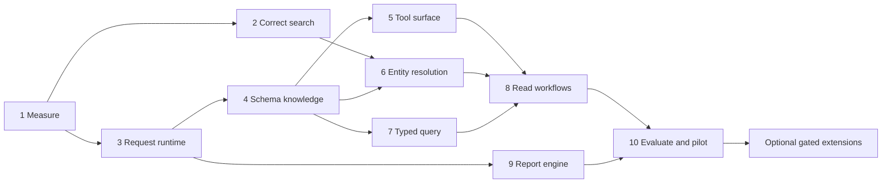

# Faster and Smarter Priority MCP Implementation Plan

> **For agentic workers:** REQUIRED SUB-SKILL: Use superpowers:subagent-driven-development or superpowers:executing-plans to implement this plan task-by-task. Steps use checkbox (`- [x]`) syntax for tracking.

**Goal:** Reduce time and tool calls needed for a correct, evidenced Priority answer, while preserving write verification, tenant isolation and complete financial calculations.

**Architecture:** Keep the TypeScript MCP server. Add shared measurement, scheduling/coalescing, scoped schema knowledge and typed read services. Offer a smaller opt-in tool profile and accurate entity resolution before considering persistent indexes or external providers.

**Tech Stack:** Node >=22.13, TypeScript, current SDK 1.32.2 / negotiated 2025-11-25 protocol, Zod 4, Vitest 4. Optional later SQLite FTS5; no Redis, vector database or second LLM in the core program.

**Spec:** [Design and source evidence](../specs/2026-10-25-mcp-faster-smarter-design.md). Baseline commit: `29f8959`, release 0.2.0.

**Execution status (2026-10-25):** Tasks 1–9 and the offline portion of Task 10 implemented and independently reviewed. Final clean-revision benchmark: 9 workloads × 50 samples; engine evaluation: 120/120 with the disclosed source-identity sidecar. Host evaluation, live pilot and activation remain unchecked. [Verification record](../../audits/2026-10-25/faster-smarter-verification.md).

## תקציר מעשי

**ההמלצה: לשפר קודם את התשתית והחיפוש הקיים, ואז להוסיף הבנה טובה יותר של משימות.** לא להתחיל בהחלפת כל השרת או בהוספת מודל נוסף.

| שלב | מה ישתפר בפועל | סדר גודל |
| --- | --- | --- |
| 1 — מדידה ודיוק | נראה איפה הזמן הולך; החיפוש לא יפספס רשומות בגלל דף קצר | 1–2 ימי הנדסה |
| 2 — מהירות | קריאות כפולות יתאחדו; מטא־דאטה ממוקד; תורים ומטמון מוגבלים | 3–4 ימים |
| 3 — חיפוש והבנה | זיהוי לקוח/מוצר בעברית ובאנגלית; פחות כלים מבלבלים; שאילתות מתוקפות | 4–5 ימים |
| 4 — משימות ודוחות | תמונת לקוח/הזמנה/יבוא בקריאה אחת; דוחות עם התקדמות והמשך | 4–5 ימים |
| 5 — הוכחה והפעלה מדורגת | השוואה מול תרחישים קבועים, בדיקה בחיבור האמיתי ואפשרות חזרה | 2–4 ימים |

**סה״כ מומלץ: 14–20 ימי הנדסה**, ללא זמני המתנה לרישוי/גישה/אישור הפעלה. שיפור ראשון שימושי: 4–6 ימים. אלה אומדני ביצוע, לא הבטחת ביצועים ולא זמן העבודה על כתיבת התוכנית.

המדידה המקומית כבר הוכיחה: 20 קריאות זהות יצרו 20 בקשות; רשימת הכלים היא 113,577 בתים; חיפוש עם דפים קצרים פספס התאמה קיימת. יעדי הביצועים והבדיקות מפורטים בהמשך. **אין עדיין מדידת מהירות חיה מול Priority.**

## Global Constraints

- User approved execution with “בצע” on 2026-10-25. Local source, tests, docs, build and task commits are authorized. No ERP mutation, publication or production activation is included.
- Preserve all 105 existing tool names in the full compatibility profile; 24 unsupported handlers and 5 guides do not become executable by implication. New tools are additive.
- Preserve default read-only, previews, explicit write authorization, no automatic retries of ambiguous writes, uncached readback and before/after mutation cache-generation fencing.
- Every data cache/index/handle is scoped by backend, company and authenticated visibility; rateScope is separate and excludes company/profile/policy; policy/credential changes cannot inherit broader visibility. Report completeness, observation time and exact record provenance are mandatory.
- Proposed core limits: 4 in-flight attempts, 2 heavy-report attempts, 100 pending attempts; default unset cloud rate 90/minute; 20-second interactive and 120-second report/discovery budgets; 32MiB/500-entry response cache, max cacheable entry 2MiB; separate 16MiB/256-entity schema cache.
- Schema soft/hard TTL: 1h/24h; stale schema may inform read discovery only. Capability TTL 5min, transient/auth verdict TTL 30s. Financial/stock response TTL <=15s, other business responses <=60s. All remain subject to write fences.
- Keep the installed protocol contract until client compatibility is proved. No unsolicited progress without a token; no universal query executor, silent SKU substitution, inferred bank clearing or carrier-delivery claims.

## Review Focus

1. Same company with different credentials/policies: zero cached data, alias, cursor or schema-access leakage — Tasks 3, 4, 6, 8, 9.
2. A read spans a concurrent write; one coalesced subscriber cancels; queued work expires: preserve generation fencing and do not abort another subscriber — Task 3.
3. Short/oversized/looping pages, partial nested lines and records changing during pagination: completeness stays explicit — Tasks 2 and 9.
4. Similar Hebrew names, leading-zero IDs, stale aliases or unavailable sources: ambiguity stays visible and cannot authorize writes — Tasks 6–8.
5. A host lacks profile/progress/resource support, or an explicitly policy-blocked component is requested through a workflow: degrade explicitly without policy bypass — Tasks 5, 8–10.

## Delivery order and ownership

The request/runtime interfaces come before their consumers. Avoid parallel edits to `priority-client.ts`, `tool-registry.ts` and `sales-report.ts`. Root execution ruling: interdependent source interfaces are committed as one verified coherent integration, with separately recorded task ownership/reviews and a follow-up evidence commit; no automatic pushing/deployment. Suggested review checkpoints: after Task 3, after Task 8, and final Task 10.



## Shared interfaces

Use these names consistently. Types go in `src/runtime/types.ts` unless a task specifies a narrower module.

```ts
type WorkClass = 'interactive' | 'report' | 'discovery' | 'verification';
interface OperationContext {
  traceId: string; toolName: string; workClass: WorkClass;
  deadlineAt: number; signal: AbortSignal;
}
interface EvidenceMeta {
  source: string; observedAt: string | null;
  freshness: 'live' | 'cached' | 'stale' | 'unknown';
  complete: boolean | null; warnings: string[];
  traceId: string; nextCursor: string | null;
}
interface ReadBudget { maxRows: number; maxPages: number; deadlineAt: number }
type RecordIdentity = { form: string; keys: Record<string, string | number> };
```

`backendScope` is an internal opaque fingerprint; never a credential or user-visible authorization token. Client instances own it. Policy checks are explicit in services; operation context does not replace authentication. Legacy payloads remain compatible while metadata is added.

### Task 1: Establish repeatable measurements and golden workloads

**Estimate:** 0.5–1 day. **Depends on:** baseline only.

**Files:** create `src/runtime/{types,metrics,operation-context}.ts`, `scripts/benchmark-mcp.mjs`, `tests/metrics.test.ts`, `tests/fixtures/performance/`, `docs/performance.md`; modify `src/lib/tool-registry.ts`, `src/client/priority-client.ts`, `src/logger.ts`, `package.json`.

**Interfaces:** `withOperation<T>(ctx: OperationContext, run: () => Promise<T>): Promise<T>`, `currentOperation(): OperationContext | undefined` backed by AsyncLocalStorage; `recordMetric(event: MetricEvent): void`; `metricsSnapshot(): MetricsSnapshot`. MetricEvent fields are static tool/form/method, phase, durationMs, bytes, outcome, cache status; no request parameters. Bounded aggregate counters/histograms cap dynamic form labels at 256 with an overflow bucket.

- [x] **Test:** `metrics redact secrets and raw queries; nested operation contexts remain isolated`: two concurrent contexts produce distinct trace IDs; synthetic PAT, customer name, filter and URL never occur in captured logs; 1,000 dynamic form labels leave <=257 form buckets.
- [x] **Run RED:** `npx vitest run tests/metrics.test.ts`; expected missing measurement/context implementation.
- [x] **Implement:** instrument registry, queue/network/retry/cache/serialization boundaries and replace debug raw-URL/error-body logging with sanitized classifications. Keep stderr for logs. Expose aggregate diagnostics only through an optional `priority_healthcheck` local diagnostics argument, without backend business data.
- [x] **Run GREEN / baseline:** build, focused tests, then `npm run benchmark:mcp -- --mode=offline --output=...`. Capture revision, Node/platform, payload bytes, process vs in-memory mode, cold/warm state and 50 samples for latency gates. Separate one-time historical audit reproduction from maintained benchmarks.
- [x] **Review/commit:** `test: add MCP latency attribution and workload benchmarks`. Gate: no startup ERP I/O, no secrets, no unbounded metric labels. Document that external host/model turn timing requires a separately recorded host replay.

### Task 2: Correct search completeness before accelerating it

**Estimate:** 0.5–1 day. **Depends on:** Task 1 for measurement.

**Files:** modify `src/lib/search.ts`, `src/lib/paginate.ts`, `src/tools/{customers,products,suppliers}.ts`; create `tests/search-pagination.test.ts`; extend existing search tests.

**Interfaces:** extend `SearchOptions` with `signal?: AbortSignal`, `deadlineAt?: number`, `cursor?: string`; extend result meta with `complete`, `stopReason`, `nextCursor`. Reuse `fetchAllPages` envelope mode and `client.listNext`; keep existing strategy/scanned/truncated fields. Temporary search cursors are validated server-owned state, not arbitrary URLs from callers; use the handle store defined in Task 9 only once available, and until then return a non-resumable explicit scan boundary rather than an opaque-looking invented token.

- [x] **Test:** `short page with continuation finds row 250`; 300 synthetic rows, server page=100, requested page=500, needle at index 250 -> exactly one match. Also short page without next link continues by actual rows until empty; 600-row cap never returns 1,000; loop/oversized page cannot claim complete.
- [x] **Run RED:** `npx vitest run tests/search-pagination.test.ts tests/search.test.ts`; reproduce the saved baseline miss.
- [x] **Implement:** stop treating short pages as exhaustion, preserve safe continuation, stable full-key ordering and required match fields; preserve base filters. Retain scanCap=2,000 default, mark partial/unknown absence precisely. Do not increase the cap just to conceal a correctness defect.
- [x] **Run GREEN:** targeted suites plus report regressions. Assert native contains short-page/next-link behavior too, not only fallback; ensure exact-match count and scan metadata remain correct.
- [x] **Review/commit:** `fix: preserve search continuation and truthful completeness`. Gate: no lost matches within the scanned window; no “does not exist” from an incomplete scan.

### Task 3: Add fair scheduling, read coalescing and bounded caches

**Estimate:** 2–3 days. **Depends on:** Task 1.

**Files:** create `src/client/{request-scheduler,read-coalescer}.ts`; modify `src/client/{priority-client,rate-limit,cache}.ts`, `src/config.ts`, `src/{server,http,index}.ts`, `src/lib/tool-registry.ts`, `.env.example`; create `tests/{request-scheduler,read-coalescer,cache-budget}.test.ts`; retain `tests/cache-write-race.test.ts`.

**Interfaces:** `rateScopeFor(config): string` fingerprints normalized deployment origin/environment (excluding company/language) + authentication material; optional operator-only `PRIORITY_RATE_SCOPE` substitutes a shared account label, namespaced by deployment. A refcounted process-local scheduler pool excludes profile, policy, cache TTL and read-only settings. Same-account active configs use minimum limits; different tokens for the same user need the explicit account mapping. `RequestScheduler.acquire(ctx: OperationContext): Promise<() => void>` returns an idempotent release; internal rate acquisition is per attempt. `PriorityClient.close()` releases the pool lease from stdio/HTTP owners; shared injected clients are closed by their owner exactly once. `ReadCoalescer.run<T>(key: string, ctx: OperationContext, fetcher: (signal: AbortSignal) => Promise<T>): Promise<T>`. Existing client read signatures remain; they inherit currentOperation, with explicit signal/budget taking the stricter bound. `Cache.set` accepts accounted bytes and existing generation.

- [x] **Test:** 20 same-scope identical GETs -> one fetch; two scopes -> two; `cache:false` never shares; one subscriber abort leaves another successful; all abort stops queue/fetch; a write between request starts blocks old-generation cache fill. Same credential across two profiles/companies shares rate budget; two credentials with the same explicit rateScope share budget but never data. Different scope limits resolve to the minimum. Pending=100 rejects the 101st with `queue_full`; 4 global/2 heavy caps hold. Cancellation settles <100ms with fake clock and no later fetch. 429 pause respects remaining deadline; retry attempts count toward rate. Separate interactive and report queues cannot starve either class.
- [x] **Run RED:** the three new suites plus `cache-write-race`, `client-cancellation` and `http-runtime`.
- [x] **Implement:** strict shared limits from Global Constraints; reserve a turn for interactive/verification work after at most two report admissions, while serving a waiting report within four interactive admissions. No parallelism increase on writes; no fairness mechanism bypasses rate limits. Add operator-only `PRIORITY_RATE_SCOPE`, `PRIORITY_MAX_CONCURRENCY`, `PRIORITY_MAX_PENDING`, `CACHE_MAX_BYTES`, retain `RATE_LIMIT_PER_MINUTE` explicit override. Cache eviction is byte+entry based; oversized responses skip cache. A streamed body-size ceiling is explicit and yields an incomplete/error result, never silently clipped JSON.
- [x] **Run GREEN:** scheduler/coalescing/load fixtures and existing mutation fencing tests. Enforce a 16MiB ordinary read-body limit and 32MiB explicit full-metadata limit; operators must opt into larger values. Test oversize compressed/uncompressed body handling by counting consumed decoded bytes.
- [x] **Review/commit:** `perf: coalesce scoped reads and bound request scheduling`. Gate: 20-to-1 exact dedupe, no stale verification, no orphan queue entries and no new 429s under the fixed synthetic workload. Record external shared-user quota limits; do not claim multi-process coordination.

### Task 4: Unify targeted schemas and capability evidence

**Estimate:** 1–1.5 days. **Depends on:** Task 3.

**Files:** create `src/lib/{schema-service,capability-store}.ts`; modify `src/lib/{forms,capabilities,search,priority-schema}.ts`, `src/tools/{meta,generic,capabilities}.ts`, `src/resources/index.ts`, `src/server.ts`; create `tests/{schema-service,capability-store}.test.ts`.

**Interfaces:** `SchemaService.get(form: string, options: { purpose: 'read'|'write'; allowFullScan?: boolean; force?: boolean }, ctx: OperationContext): Promise<{schema: CsdlEntity|null; evidence: EvidenceMeta}>`; `CapabilityStore.get/put(scope, form, operation, verdict)` with supported/unsupported/denied/unknown, checkedAt and expiry. Factory `knowledgeFor(client): {schemas, capabilities}` uses scoped ownership, not a process-wide tenant-blind singleton.

- [x] **Test:** one supported entity -> one `GetMetadataFor`, zero `$metadata`; 20 concurrent same-form requests -> one fetch/parse; second session shares evidence only for the same client scope. 401/network failure never becomes unsupported. Expired write schema blocks until refreshed; a read may explicitly return stale hints. A 501 for one form/function does not disable another form's contains support.
- [x] **Run RED:** new suites plus existing forms/capability/resource tests.
- [x] **Implement:** targeted first, optional full fallback after classified unsupported response; bounded parsed-schema cache and evidence TTLs from Global Constraints. Port attachment discovery and schema resources to the same service. Keep full entity enumeration an explicit expensive operation. Historical static fields become scoped hints; reject an unverified field in a new schema-dependent write plan.
- [x] **Run GREEN:** XML/JSON equivalence, one-parse counters, metadata TTL/failure tests; no “sample record proves mandatory fields” inference; no automatic mutation retry after schema drift.
- [x] **Review/commit:** `perf: share targeted schema and capability evidence`. Gate: warm known schema/capability read makes zero ERP calls; fresh evidence is dated and cannot override allow/block policy.

### Task 5: Offer a compact stable tool surface and useful outputs

**Estimate:** 0.75–1.5 days. **Depends on:** Task 4; profiles can enable future tools only after their tasks land.

**Files:** create `src/lib/{tool-profiles,result-contracts}.ts`; modify `src/lib/{tool-registry,tool-result,capability-definitions}.ts`, `src/tools/{index,capabilities}.ts`, `src/prompts/index.ts`, `src/config.ts`, `scripts/generate-tool-docs.mjs`; create `tests/{tool-profiles,result-contracts}.test.ts`.

**Interfaces:** `effectiveTools(profile: 'full'|'operations', config): string[]`, `formatResult(data, {mode:'summary'|'detail', rowLimit, meta}): CallToolResult`. `priority_get_capabilities` gains `view:'summary'|'detail'` and `names?:string[]`; existing default response remains compatible. New result contracts use `EvidenceMeta`; outputSchemas describe real fields rather than `{}`.

- [x] **Test:** full profile retains 105 legacy names; operations manifest <=25 and <=40,000 bytes; stable order; allow/block intersects; profile-hidden dependencies can serve a workflow only if explicit policy permits them; explicitly blocked dependencies cannot. A workflow-only allowlist blocks all undeclared component reads until their dependency names are added. New typed outputs validate; legacy fields survive. Summary is complete only when all source data relevant to its calculation was evaluated, even when display rows are fewer.
- [x] **Run RED:** profile/contract tests plus current capabilities and bounded-result suites.
- [x] **Implement:** `PRIORITY_TOOL_PROFILE=full` default. Proposed final operations set: healthcheck, capabilities, resolve_entity, list_customers, get_customer, get_customer_balance, list_products, get_product, get_stock_levels, list_orders, get_order, list_invoices, get_invoice, impfile_get, impfile_preflight, prepare_query, query, get_record, get_entity_metadata, customer_snapshot, order_diagnosis, import_diagnosis, product_sales_by_period, get_open_debts, get_supplier (full `priority_` names except import tools). Omit not-yet-implemented additions until their task lands. This profile focuses on reads; write operations remain in full.
- [x] **Run GREEN:** protocol snapshot/compatibility tests; summaries target <=8,000 text chars, hard ceiling 24,000. Avoid formatting twice; preserve structured/text equivalence. Move long help to resources with ordinary text fallback when the host ignores resources. Prompts use targeted fresh capability evidence, not a mandatory whole-catalog preamble.
- [x] **Review/commit:** `feat: add compact tool profile and typed result summaries`. Gate: byte reduction is recorded; actual model quality/token impact remains unclaimed until Task 10.

### Task 6: Resolve Hebrew/English entities without guessing IDs

**Estimate:** 1.5–2 days. **Depends on:** Tasks 2, 4, 5.

**Files:** create `src/lib/{entity-resolver,name-normalization,entity-aliases}.ts`, `src/tools/entity-resolution.ts`, `tests/entity-resolver.test.ts`, `tests/fixtures/resolution/`; modify tool registration/catalog and relevant search tools.

**Interfaces:** `resolveEntity({kind:'customer'|'supplier'|'product', query:string, limit?:number}, ctx): Promise<{status:'resolved'|'ambiguous'|'not-found-in-scan'; candidates:Array<{identity:RecordIdentity; displayName:string; rank:number; matchReasons:string[]}>; meta:EvidenceMeta}>`. `priority_resolve_entity` wraps it. Alias records are `{scope,kind,alias,identity,source,reviewedAt}`; only checked-in synthetic aliases in tests, private reviewed mappings at runtime.

- [x] **Test:** exact ID/barcode resolves; codes `0012` and `12` remain different; Hebrew niqqud/spacing variants produce candidates; duplicate aliases remain ambiguous; near-identical companies never silently merge. Cross-scope alias lookup misses. Index candidates require an uncached exact permission/record read before names or IDs are exposed; denied candidates disappear and read timeout returns verification-unavailable with no cached candidates. Test policy revocation before a daily rebuild.
- [x] **Run RED:** resolver fixtures. Development and held-out datasets must be separate; no training on held-out expected answers.
- [x] **Implement:** exact lookup -> reviewed aliases -> normalized lexical search; no embedded LLM or vector service. Preserve original query and IDs, attach explainable reasons and coverage. Reuse backend projections and scheduler. In-memory candidate index is optional; its source completeness is recorded and memory is bounded. Verify at most five ranked candidates uncached under current credentials before emitting current values; ranking does not bypass current authorization.
- [x] **Run GREEN:** exact/curated unique match accuracy 100%; held-out candidate recall@3 >=95%; silent ambiguous auto-selections=0. All source text remains data, not tool instructions.
- [x] **Review/commit:** `feat: add scoped entity resolution with explicit ambiguity`. Gate: write consumers must perform their own uncached current-record check; resolver output alone never authorizes a write.

### Task 7: Prepare typed queries with bounded recovery

**Estimate:** 1–1.5 days. **Depends on:** Tasks 3, 4, 5.

**Files:** create `src/lib/{query-plan,query-validation}.ts`, `src/tools/query-planning.ts`, `tests/query-plan.test.ts`; extend `src/client/odata-builder.ts` as necessary without changing raw generic-query semantics.

**Interfaces:** `prepareReadQuery(input: {form; fields; filters: Array<{field; op:'eq'|'ne'|'gt'|'ge'|'lt'|'le'|'contains'; value:string|number|boolean}>; dates?:{from?:string;to?:string}; expand?:string[]; top?:number}, ctx): Promise<{query:string; source:RecordIdentity['form']; costClass:'small'|'scan'|'heavy'; reasons:string[]; meta:EvidenceMeta}>`. `priority_prepare_query` returns a preview, never executes a mutation. Follow-up execution uses existing authorized read tools.

- [x] **Test:** unknown fields stop before data query; unsupported contains suggests a resolver path; 2026-02-30 rejects; date-only upper bound includes fractional seconds; full composite sort keys remain stable. Escaped Hebrew/quotes cannot inject a second filter. Unbounded expansion is rejected with a narrower alternative.
- [x] **Run RED:** `npx vitest run tests/query-plan.test.ts`.
- [x] **Implement:** schema-validated projections, typed predicates, date field mapping, default top=50/max=500, expand depth<=1/max 2 subforms. Cost class is a heuristic, not an invented latency estimate. One read-only schema refresh/rebuild may recover unknown-property drift within the same deadline; never retry a mutation.
- [x] **Run GREEN:** source-injection, unknown-form and unsupported-field fixtures; no second schema-correction loop. Check raw `priority_query` compatibility separately.
- [x] **Review/commit:** `feat: prepare bounded schema-aware read queries`. Gate: reasons explain source/projection/cost; no hidden full-table fallback.

### Task 8: Add three evidence-backed read workflows

**Estimate:** 1.5–2.5 days. **Depends on:** Tasks 5–7.

**Files:** create `src/services/{customer-snapshot,order-diagnosis,import-diagnosis,read-policy}.ts`, `src/tools/workflows.ts`, `tests/read-workflows.test.ts`; extract reusable reads from `src/tools/{customers,orders,invoices,impfiles}.ts`; register catalog/profile entries.

**Interfaces:** each workflow accepts an exact key or a resolver-confirmed unique identity, sections and a shared `ReadBudget`; returns `{identity, sections: Record<string,{status:'available'|'blocked'|'failed'|'incomplete'; data?:unknown; meta:EvidenceMeta}>, meta:EvidenceMeta}`. `assertReadDependencyAllowed(config, legacyToolName)` is called before every corresponding component. All component data is bounded and provenance-backed.

- [x] **Test:** blocked `priority_get_customer_balance` remains blocked inside customer_snapshot; no alternate generic read bypass. Partial invoices do not null out a successful identity section. One import snapshot feeds all diagnosis checks. Shipment label != carrier delivery, ledger != bank receipt; missing source remains unavailable. Similar-name records require selection first.
- [x] **Run RED:** workflow fixtures plus existing order/import/revenue tests.
- [x] **Implement:** explicit dependency map. Customer: get_customer + bounded list_orders/list_invoices + get_customer_balance. Order: get_order + get_order_shipment_status, only supported links. Import: impfile_get + impfile_preflight + impfile_landed_cost from one snapshot, with per-component policy checks. Shared services are functions, not nested MCP RPC calls; policy is still enforced.
- [x] **Run GREEN:** simulated dependency latency tests prove independent reads overlap within max concurrency=4; dependent reads stay ordered; complete source values produce identical existing calculations. One tool call is not misreported as one backend request.
- [x] **Review/commit:** `feat: add customer order and import read diagnostics`. Gate: every returned conclusion has source/observation/completeness; no business write side effects.

### Task 9: Improve long reports, progress and bounded continuation

**Estimate:** 2–3 days. **Depends on:** Tasks 2–4; Task 8 shares the service patterns.

**Files:** create `src/services/reports/{sales-reader,window-runner,sales-aggregate}.ts`, `src/lib/result-handles.ts`, `tests/{report-performance,result-handles}.test.ts`; modify `src/tools/{sales-report,finance,invoices}.ts`, relevant read services and resources. Preserve existing report regression fixtures.

**Interfaces:** `runWindows(windows, {concurrency:2, ctx, onProgress}, reader): Promise<WindowResults>`; `ResultHandles.create/get/remove` stores typed state keyed by random 256-bit opaque handles, scoped to backend+policy+boot+query+generation. TTL=15min, max=100 handles/scope, max=16MiB retained state; reject expired/wrong-scope/changed-generation handles. Result page size max=100; format only after calculations.

- [x] **Test:** serial/2-window totals identical for final/draft/credit/cancellation/nested/delivery cases; no double-count across overlap; partial invoices prevent unsafe delivery inclusion. Resume rereads the entire last completed window per source plus every partial/missing window, replacing prior contributions; earlier completed windows stay retained. A changed row in a replaced window updates totals once, while a changed earlier retained window remains explicitly outside resume freshness. Full-refresh discards all contributions. Output includes `coverageComplete`, `consistency:multi-observation`, `snapshotConsistent:false`, observation range and retained/recomputed window lists; `complete:true` never implies a transactionally consistent instant. Cross-scope/expired/changed-policy handles reject. Pagination after formatting does not silently discard detail. Progress strictly increases and uses only supplied active tokens.
- [x] **Run RED:** new report/handle suites plus `report-regressions`, `revenue`, `client-cancellation`.
- [x] **Implement:** two independent windows maximum, sequential per-window continuations, overall deadline including queue/sleep/parse. At most one transient retry per window after client policy budget; no multiplied retry layers. Progress throttled to >=2 seconds between notifications; never use elapsed time as a fake completed-row count. Return missing windows and explicit observation range. Keep per-source/window contributions for replacement; never accumulate a re-read window twice. If contributions exceed the handle memory bound, return non-resumable evidence and a full-refresh path. Even complete coverage declares multi-observation consistency; backend changes during scans remain possible.
- [x] **Run GREEN:** golden totals and 50-sample synthetic network fixtures; max 4 total/2 heavy requests; cancellation leaves no live fetch/queue. Use handles for opt-in detail pages and search continuation; legacy fields remain. Handle eviction returns expired/restart-required, not “empty result”.
- [x] **Review/commit:** `perf: schedule bounded report windows and expose progress`. Gate: no correctness loss to meet time limits; no claim of database snapshot consistency. Only then assess >=25% live cold-report p95 goal in Task 10.

### Task 10: Prove quality and run a staged read-only pilot

**Estimate:** 1.5–2.5 days plus external access/waiting. **Depends on:** Tasks 1–9.

**Files:** create `tests/fixtures/evaluation/`, `scripts/evaluate-mcp.mjs`, `scripts/profile-readonly.mjs`, `docs/performance-rollout.md`; update `.github/workflows/ci.yml`, README, tool/deployment/security docs and changelog.

**Interfaces:** `EvaluationCase` includes prompt/query, authorized tools, expected ID set, ambiguity action, source/claim constraints and exact fixture outcome. `EvaluationReport` separates deterministic engine results from host/model trials, each tied to revision and config. Live profiler requires an explicit `--live --scenario-file` allowlist, read-only client and a hard total request budget; no default tenant-wide discovery.

- [x] **Test dataset:** 120 scenarios: 40 entity lookup, 30 query/error recovery, 30 workflows/reports, 20 guard/unknown-evidence cases. Freeze 80 development / 40 held-out. Include empty data, broken metadata, permission revocation, multiple currencies, backdated changes, long Hebrew text and unsupported hosts. Record expected factual outcomes independently of implementation.
- [x] **Offline verification:** full tests/build/lint/stdio/HTTP/package/Docker; repeat Node 22.13 and supported CI versions. CI enforces deterministic call counts, limits, contracts and 20-to-1 dedupe; latency gates use a pinned runner with repeated samples, not brittle nanosecond assertions.
- [ ] **Host evaluation:** replay held-out prompts with identical model/settings, first full profile then operations profile, 3 repetitions/case. Capture chosen tools, number of assistant/ERP calls, tokens only if the host reports them, and source-grounded correctness. >=95% correct target choice; zero fabricated evidence or silent ambiguous selection; >=40% fewer assistant calls on multi-step cases.
- [ ] **Live pilot:** after separate activation authorization, collect at least 50 comparable samples per selected workload/cache state using existing normal traffic or a low-rate explicit script. Keep total profiler calls <=200/run and <=30/minute, also under the shared production budget. If the sample budget is insufficient, report insufficient evidence and extend across approved observation periods; never fabricate p95 from a few calls. Warm vs cold and API vs host latency stay separate.
- [ ] **Release/rollback:** enable coalescing/schema first, resolver/workflows second, profile/report concurrency last. Proposed env rollback switches: `PRIORITY_COALESCE_READS=false`, `PRIORITY_TOOL_PROFILE=full`, `PRIORITY_REPORT_CONCURRENCY=1`, `PRIORITY_SEARCH_INDEX=off`; preserve previous artifact for schema/runtime rollback. Stop on any wrong total, stale write verification, scope leak, material 429 increase or p95 regression >10% at equal workload. Record comparison, publish only after authorized release review.

## Optional extensions — gated, not prerequisites for core completion

| Extension | Entry test and proposed scope | Estimate | Do not enable when |
| --- | --- | --- | --- |
| Persistent master-data index | Only if warm resolver still misses latency/recall targets. `src/search/{store,sync}.ts`, separate SQLite FTS5, exact ID/name/status/verified barcode; 5-minute overlap, watermark after complete scan, daily full reconcile; uncached current authorization before returning every candidate; private files | 2–4 days | `$since`/modification fields, delete semantics, data retention or current permissions are unverified |
| GET-only `$batch` | Fixed fixture of 3 independent reads; verify per-inner result/status/budget and >20% measured benefit; dedicated validated GET-only encoder and parser | 1–2 days | Generic POST bypass would be required, inner budgets are unknown, or no real gain |
| Official Priority MCP adapter | Read-only check of tenant version >=26.0, Cloud eligibility, licensing; compare targeted schema, search and documented reports against local evidence | 1 day discovery + 2–5 days if justified | Tenant not eligible; procedure side effects/authorization are unresolved; no migration solely because a vendor service exists |
| Webhook invalidation / distributed scheduler | Only with existing module/handler authorization or demonstrated multi-process contention; authenticated invalidation, periodic reconciliation, no webhook-only truth | 2–4 days | It would require unapproved module purchase, public endpoint or rely on exactly-once event delivery |
| New MCP protocol or semantic retrieval | Separate compatibility matrix and held-out improvement proof; current host remains supported | 1–2 day research, implementation estimated afterward | SDK/host support is unknown, or lexical/schema/workflow improvements already meet goals |

Priority's current docs describe `$since` as form-dependent, webhook licensing, a GET-capable batch mechanism without rollback, and vendor MCP eligibility. These are options to validate, not confirmed capabilities of this tenant. See the linked primary sources in the design.

## Definition of done

The core is complete only when all task gates pass and a dated comparison shows correctness plus performance under stated conditions. If live access or client telemetry is unavailable, mark **offline-complete / live-performance-unverified**, list the exact missing measurement, and do not report percentage speedups. The 24 unsupported handlers remain an explicit separate capability backlog.

Current state: **planning complete only; none of the implementation checkboxes is completed**. Read [offline baseline](../../audits/2026-10-25/performance/baseline.json) and the [design](../specs/2026-10-25-mcp-faster-smarter-design.md) before execution. First implementation action: Task 1's measurement and golden-workload tests.
