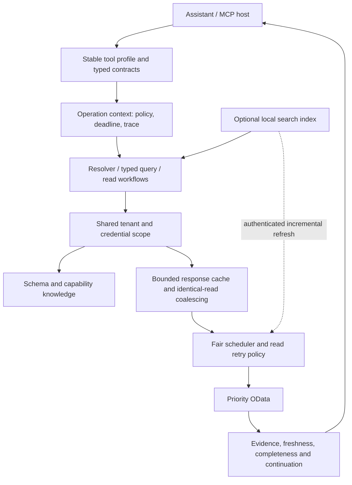

# Faster and smarter Priority MCP — design

Date: 2026-10-25. Status: core implementation completed locally; final offline verification recorded separately. Baseline: release 0.2.0, commit `29f89590b567db66949564ac2c083d65dfc6f772`. The original planning evidence below remains historical. Source implementation is local; tenant configuration and deployed runtime remain unchanged. See [verification record](../../audits/2026-10-25/faster-smarter-verification.md).

## Intent and decisions

Improve time to a **correct, evidenced answer**, not just raw request speed. Reduce redundant ERP requests and unnecessary model round trips; resolve Hebrew/English customer/product/supplier names reliably; return compact answers with traceable source records and explicit incompleteness. Keep this TypeScript server and its existing write safeguards.

The user requested a full plan for a faster, smarter MCP. No workload preference was supplied during the optional clarification. The proposed priority is balanced across search, customer/order context, reports and import-file diagnosis. Budgets, architecture and rollout defaults below are engineering recommendations, not user-approved production settings.

## Verified baseline

Measured with synthetic data and a fake backend; no real Priority request or credential was used. Reproduce with `node docs/audits/2026-10-25/performance/reproduce.mjs --output /tmp/priority-performance-replay.json` after building the baseline checkout. Save subsequent runs separately so the original JSON remains evidence.

| Finding | Current evidence | Consequence |
| --- | --- | --- |
| Tools/list surface | 105 tools, 113,577 serialized UTF-8 bytes; 34,698 description bytes; 24 unavailable handlers | Large discovery surface. Actual model-token cost and tool-selection error rate are not measured. |
| Capability catalog | Asking for top=100 needed 3 calls and 94,189 combined serialized bytes to return all 105 entries | Capability-prefixed prompts can add round trips and context. Text and structured content are both included in this wire measurement. |
| Duplicate in-flight reads | 20 concurrent identical reads produced 20 fake backend calls; a subsequent warm call produced zero | Completed-result caching exists, request coalescing does not. This is call amplification, not proof of 20x latency. |
| Single-form schema | `priority_get_entity_schema(CUSTOMERS)` requested `$metadata` | It loads the whole schema even though another existing tool already uses `GetMetadataFor`. |
| Fallback search correctness | 300-row fixture, server page cap 100, target at index 250: zero matches, scanned=100, scanCapped=false | `search.ts` ignores the next link and assumes a short page is the end. Fix this before calling search faster. |
| Result CPU | 20,000 synthetic rows / 1,088,925 input JSON bytes: direct formatter median 14.655 ms, sample p95 15.673 ms, 10 measured runs | Not the primary latency suspect. Prefer source projection and bounded pages before CPU rewrites. |
| Runtime defaults | 60-second response cache, 500-entry cap without byte cap; 120 calls/minute; 120-second request timeout | Need byte budgets, cancellation-aware queueing and a documented deployment rate budget. |
| Remaining architecture | Catalog probe evidence belongs to each MCP server; rate-limit wait has no AbortSignal; full metadata parsing repeats; no end-to-end performance counters | Time is not yet attributed to queue/network/parse/serialization/model turns. |
| Protocol | Installed SDK 1.32.2 advertises 2025-11-25 and older versions | Current public 2026-07-28 features cannot simply be copied into this runtime. |

Code anchors: `src/client/priority-client.ts:306`, `src/client/rate-limit.ts:11`, `src/client/cache.ts:13`, `src/lib/search.ts:169`, `src/tools/meta.ts:104`, `src/lib/tool-registry.ts:31`, `src/tools/sales-report.ts:306`, `src/lib/capabilities.ts:38`, `src/prompts/index.ts:4`. Line numbers refer to the baseline commit.

Historical comments report a roughly 65-second service-document read and 7–10MB metadata in July. These are historical tenant observations, not current measurements. Current live p50/p95, traffic distribution, ERP version, server concurrency and token use remain unknown. The 309 passing correctness tests from the release are not performance measurements.

## Alternatives and recommendation

| Approach | Value | Tradeoff | Decision |
| --- | --- | --- | --- |
| Improve the existing server | Keeps current tools, business mappings and verified writes; immediate measurable request savings | Requires careful shared infrastructure changes | Recommended core program |
| Add a controlled adapter to Priority's official MCP | Potentially useful vendor-native full-text search, help and procedures | Vendor documents Cloud + ERP 26.0+, API licensing and access prerequisites; this tenant's current eligibility is unknown | Read-only discovery spike later; no automatic replacement |
| Full local replica/vector database or new LLM inside the server | Could help large historical analysis or difficult semantic lookup | Sync, deletion/permission drift, operating cost and evidence risks before basic bottlenecks are fixed | Defer until measurement proves the simpler design insufficient |

Priority's official MCP is a separate service with its own requirements, not a dependency already installed here. See [official introduction and prerequisites](https://prioritysoftware.github.io/mcp/).

## Target architecture

Scope is always service root + company + authenticated visibility + configuration generation. Company alone is insufficient. Credential changes create a new scope. Request budgets have a separate rateScope: normalized deployment origin/environment (without company/language) plus a fingerprint of authentication identity. It excludes read-only mode, tool policy, cache TTL and profile, so one credential used by multiple companies/profiles shares one scheduler. An optional operator-only `PRIORITY_RATE_SCOPE` groups different credentials known to belong to the same API user; never accept this value from a tool call. Without that mapping, two tokens belonging to one user cannot be reliably unified; state the limitation. Active configurations sharing a rateScope use the most restrictive limits. Data must never cross authorization boundaries, even when rateScope is shared. This is still process-local; other processes require an external shared quota or deliberately divided budgets.

### 1. Measure before tuning

Introduce low-cardinality measurements at registry/client/cache boundaries: total tool time, queue wait, network attempt time, retry sleep, JSON/schema parse time, serialization time, payload bytes, cache hit/miss/coalesced, backend calls, rows/pages, incomplete outcomes and cancelled work. Logs record tool/form/operation/status plus opaque trace ID; no raw URLs, filters, names, document IDs, credentials or payloads. Existing debug logging of full URLs must be replaced.

Use a request-local operation context and bounded aggregate counters/histograms, not an unbounded per-request log in RAM. Track engine latency separately from model and MCP-host round trips. Offline benchmarks run without network; a later opt-in live profile uses preselected read-only scenarios and emits aggregates only. No perpetual polling or background tenant scan starts by default.

### 2. Faster requests without stale write verification

Add a shared scheduler with default maximum **4 in-flight attempts per rateScope**, **2 heavy-report attempts**, **100 pending attempts**, and an operator-configurable rate budget. Recommend an unset cloud-safe default of **90 attempts/minute**, retaining explicit lower limits. An explicit larger override requires the operator's verified limit; emit a configuration notice, not an unsupported claim that every on-premise server has the cloud limit. The documented cloud fair-use policy currently says 100/user/minute and 10 processing + 5 queued; the local default is 120. Other processes sharing the same API user consume the same external budget. Document this instead of pretending an in-process limiter coordinates all integrations. [Priority REST introduction](https://prioritysoftware.github.io/restapi/)

Queue wait, retries and body reading consume a single operation deadline. Reads use 20 seconds for interactive lookup, 120 seconds for reports and explicit full discovery; callers may request a lower budget. Existing explicit report deadlines stay supported. A cancelled queued operation settles within 100ms and never reaches fetch. A clean 429 establishes a shared Retry-After pause; one bounded jittered retry policy owns retry decisions, preventing client x report retry multiplication. Permanent 400/401/403/404/501/505 errors do not get generic retries. Adaptive report splitting consumes the same total budget.

Coalesce only identical, cacheable GETs in the same scope and cache generation. Preserve exact URL semantics; do not rewrite filters to increase hit rate. `cache:false` verification, mutations and reads during a write fence bypass sharing. Cancelling one subscriber does not cancel other subscribers; all subscribers cancelling aborts the shared fetch. Rejected promises are removed. Keep the existing before/after mutation generation fence and broad financial-data invalidation.

Keep business response TTL at 60 seconds unless a form policy shortens it; financial/stock summaries default to 15 seconds and always expose observation age. New response cache bound: **32MiB accounted payload bytes, 500 entries**, skip caching entries over **2MiB**. These are serialized-byte accounting limits, not an exact V8 heap guarantee. Metadata uses a separate **16MiB/256-entity** cache so master schemas do not evict ordinary results. Do not introduce stale-while-revalidate for financial results or any write precondition.

### 3. Share schema knowledge, with provenance

Unify `priority_get_entity_schema`, `priority_get_entity_metadata`, schema resources and attachment/subform discovery behind one tenant-scoped `SchemaService`. Prefer targeted `GetMetadataFor`; parse once. Full `$metadata` is an explicit fallback only when targeted metadata is unsupported and the caller permits its higher cost. Auth/network failures are not “unsupported”. Sample records do not prove required fields, keys or complete schema.

Metadata soft TTL 1 hour, hard TTL 24 hours: stale metadata can be shown for read discovery with `stale:true`, but write planning requires a refresh after soft expiry. A refresh failure blocks schema-dependent new writes, rather than treating an old guess as current. Existing historical schema tables become scoped hints with provenance, not universal tenant facts. Unknown tenants can still use explicit generic operations; metadata does not invent accounting semantics.

Merge form and function evidence into a shared per-client store: source, checkedAt, expiry, status, supported operations/projections. Record `contains` support per form/function, not one permanent client-wide boolean after any 501. Capability read TTL 5 minutes; auth/transient failures 30 seconds, still classified unknown/denied rather than absent. Refresh single-flights across sessions; explicit force refresh is bounded and distinct from reuse of fresh evidence.

Priority documents entity-specific metadata and warns that full metadata can be slow. [Metadata requests](https://prioritysoftware.github.io/restapi/request/)

### 4. Make search understand identifiers and ambiguity

First fix the existing fallback: use the envelope paginator, validated continuation links, stable full-key ordering, exact scan caps and a continuation contract. A cap produces `complete:false`; empty results from an incomplete scan mean “not found in scanned rows”, not “does not exist”. A 501 only disables the rejected function/form combination temporarily. A rejected select field triggers schema correction; no automatic unbounded all-column fallback.

Add `priority_resolve_entity` for customers, suppliers and products. Return exact IDs and ranked candidates with `matchReasons`, source and freshness. Order: exact identifier/barcode, curated alias, normalized name, lexical fuzzy candidates. Normalize names with Unicode NFKC, Hebrew niqqud removal and whitespace folding; never normalize stored IDs, collapse leading zeroes or silently substitute a SKU. Do not claim scores are probabilities. Auto-resolution is allowed only for a unique exact identifier or a unique reviewed alias; fuzzy candidates remain ambiguous. All future writes re-read the selected exact record uncached.

Curated aliases carry scope, canonical ID, source and review date. No automatic “learning” from arbitrary ERP text or model-generated answers. Golden Hebrew/English fixtures cover spelling variation, near-identical business names, return/credit documents, leading-zero codes and ambiguous aliases. An optional in-memory lexical index can accelerate master-data candidates; it never establishes current balance, stock or write authorization.

### 5. Reduce tool-selection and output overhead

Preserve the existing full profile and 105 names. Add an opt-in stable `operations` profile of **at most 25 tools**, checked in as an explicit ordered manifest. Hide unavailable tools only in this profile; full compatibility remains default until host A/B evaluation passes. No per-call dynamic tool enabling. Effective profiles intersect existing allow/block policy. Profile visibility is discovery only; it is not authorization. A component hidden by the compact profile can serve a workflow if allowed by explicit policy. Every new workflow and each of its legacy component dependencies must independently pass allow/block checks. With an explicit allowlist containing only a workflow name, its components are blocked until that allowlist includes the declared dependencies; document that configuration. An explicit block always wins. Do not use a generic query to bypass a blocked component.

Descriptions lead with what a tool does and when to choose it; move lengthy reference text to discoverable resources. Keep essential risk, preview and uncertainty guidance in the manifest. Add a compact capability view and names/domain filters so a prompt need not read the entire 105-entry catalog every time. Prompts reuse unexpired evidence and perform targeted refresh only when needed.

New tools use real typed output contracts. Existing tools migrate additively, retaining payload fields. Standard evidence metadata: `{source, observedAt, freshness, complete, warnings, traceId, nextCursor}`. Summary mode defaults to 25 rows and a target of 8,000 text characters; absolute legacy ceiling stays 24,000. Large detail becomes explicit pages/short-lived authenticated result resources, not silent truncation. Keep text/structured values consistent; avoid duplicate normalization in the registry. Host behavior determines whether it actually puts both versions into model context, so measure that instead of asserting a token saving from wire bytes alone.

The installed protocol supports structured results and resource links. Progress requires a supplied progress token. Latest protocol changes are a separate compatibility study; do not advertise unsupported 2026 wire fields from SDK 1.x. [MCP tools 2025-11-25](https://modelcontextprotocol.io/specification/2025-11-25/server/tools), [progress](https://modelcontextprotocol.io/specification/2025-11-25/basic/utilities/progress), [2026 tool protocol](https://modelcontextprotocol.io/specification/2026-07-28/server/tools)

### 6. Smarter query preparation and read workflows

Add a typed read query builder for known schemas: operators, projection, date field, deterministic key order, limit and expansion depth. It validates against schema, estimates heavy work, and returns a prepared query with reasons. It does not accept arbitrary model-supplied code or SQL. Raw `priority_query` remains an advanced compatibility path. One read-only schema correction may retry after an unknown-property error; no autonomous mutation retry or guessed business formula.

Add three focused read tools backed by reusable services:

- `priority_customer_snapshot`: customer identity + bounded recent orders/invoices + OBLIGO ledger exposure where supported. Ledger exposure is not bank clearing, due-date aging or proof of payment.
- `priority_order_diagnosis`: order/header/line state and linked ERP shipment evidence. ERP shipment status is not customer delivery or carrier proof.
- `priority_import_diagnosis`: one shared import snapshot feeding preflight, landed-cost observations and missing-evidence checks. Does not execute close/finalization or claim that a guide ran.

Each component reports available/blocked/failed/incomplete separately. Expected user-visible reduction is fewer assistant tool round trips, not necessarily fewer underlying ERP reads. Independent component reads share the scheduler; dependent reads remain ordered. A record graph retains exact form, full key and source for drill-down. No inferred links based only on matching amounts or similar names.

### 7. Reports and optional incremental data

Split the large sales-report handler into source readers, window scheduling and aggregation. Begin with two independent date windows in parallel, subject to the same total four-attempt cap. Follow continuation within a window sequentially. Preserve date, final/draft, credit/return, nested-line and invoice/delivery de-duplication semantics. Report calculations consume complete source pages, never formatted/truncated tool output.

Expose progress no more than once every two seconds if the client provided a token. On deadline return partial results, missing windows and a scoped opaque continuation handle; do not claim a resumable snapshot that the backend cannot provide. Phase one supports best-effort resume with explicit scanStartedAt and de-duplication, not transactional snapshot isolation. Retain contributions by source and exact date-window bounds. Resume reruns the entire last completed window for each source, every partially read window and each still-missing window; it replaces each old window contribution, never adds the replacement on top. Earlier completed windows are retained. A full-refresh mode discards all retained contributions and rereads every window. Deduplicate records by full schema key within each source. Changes to earlier retained windows may therefore be missed by resume, and the result must say so. `complete`/`coverageComplete` mean every selected window and nested continuation was covered, not a single database snapshot. Report `consistency: multi-observation`, `snapshotConsistent:false`, first/last observation timestamps and recomputed/retained window lists even when coverage becomes complete. Do not label a resumed multi-time aggregate as current-as-of-one-instant. If bounded state cannot retain the contributions, return non-resumable missing-window evidence, not a misleading handle. Handles expire after 15 minutes, max 100 per scope, max 16MiB total retained state, and are invalid after a relevant write/cache-generation change. Keys, permissions, query hash and budget are revalidated on resume.

Optional persistent search acceleration is off by default and uses a separate SQLite FTS5 store, not the demo portal DB. Restrict initial fields to exact ID, display name, active flag and verified barcode. No phone, email, tax ID, balance, invoice content or raw prompt by default. Partition by authorization scope; directory mode 0700/file 0600; no public endpoints or Git-tracked data. Rebuild/permission-revalidate at least daily; reject a stale/unrevalidated index as an authoritative source. Before any persistent or in-memory index candidate name/ID is exposed, perform an uncached exact read under the current credentials and current policy; emit the current read values only. Check at most five ranked candidates per call within the shared budget. A denied/missing record is suppressed; a timeout returns verification-unavailable without cached candidate names/IDs. The local index ranks candidates internally and reduces scans, not authorization checks. Daily reconciliation is for data maintenance, not the authorization gate.

Probe `$since` or verified modification fields per form before incremental refresh. Advance watermarks only after all pages succeed; replay a five-minute overlap and deduplicate by full key. Soft-deletes, hard deletes and permission changes require periodic full reconciliation; `$since` alone is not proof of deletion completeness. Webhooks are an optional later invalidation hint, not source truth. They require a licensed/configured module and an authenticated handler. [Change queries](https://prioritysoftware.github.io/restapi/query/), [webhooks](https://prioritysoftware.github.io/webhooks)

### 8. Deferred experiments

Read-only `$batch` can reduce network round trips, but each inner operation retains budget, status and permission handling. Implement only if profiling shows >20% benefit for a representative workflow, and classify it as a validated GET-only batch despite its HTTP POST envelope. No generic read-only bypass for arbitrary POST. Priority documents up to 100 inner operations and no rollback; mutation batches are outside this performance plan. [Batch operations](https://prioritysoftware.github.io/restapi/modify/)

A vendor MCP spike may compare read-only schema/search/report paths after version/license checks; do not invoke procedures or enable the 24 unsupported handlers automatically. Redis/distributed scheduling is justified only if multiple server processes share credentials and process-local budgets are insufficient. Vector search or an embedded LLM requires measurable gains on the held-out search suite before adding its operating cost.

## Success gates

Targets below are acceptance goals, not measured improvements. Pin hardware, payloads, host/model version and cache state for comparisons.

| Area | Gate |
| --- | --- |
| Search correctness | The short-page fixture returns the match at row 250; continuation loops/caps never yield a false complete result. |
| Coalescing | 20 identical cacheable concurrent reads -> 1 backend fetch in an unchanged generation; verification reads are never shared. |
| Schema | Single-form lookup uses at most one targeted fetch and zero full-metadata fetches when supported; warm lookup zero fetches. |
| Queueing | At most 4 concurrent attempts and configured rate; cancelled queued read settles <100ms and never fetches. |
| Context | Opt-in operations profile <=25 tools and <=40,000 serialized manifest bytes; quality cannot regress to meet the size goal. |
| CPU/cache | Warm cached lookup in-process p95 <50ms; formatter <30ms for the baseline 1MiB fixture; configured cache byte bounds respected. |
| Smarter answers | >=95% correct target-tool/record choice on held-out cases; zero silent fuzzy substitutions or unsupported financial/delivery claims. |
| Workflows | >=40% fewer assistant tool calls on the representative multi-step suite; measure API count separately. |
| End-to-end live goal | >=30% lower p95 on repeated interactive reads and >=25% lower cold report p95 versus measured baseline, same evidence completeness, no increased 429/error rate. Revisit if ERP dominates. |
| Quality/operations | Existing 309 tests remain green, golden report totals identical, no credential/scope leakage, clean shutdown and no cancelled orphan jobs. |

## Rollout and decision gates

Recommended core budget: **14–20 engineering days** including fixtures, implementation, review and staged validation. First useful slice: **4–6 days**. Optional persistent index, vendor adapter, batch and protocol migration are separate gated extensions, estimated below in the execution plan. Tenant access, approvals, licenses and backend upgrade wait times are excluded.

Baseline -> correctness fix -> request/cache/schema -> profiles/resolver/workflows -> report tuning -> read-only pilot. Enable independently with feature flags; compare a fixed replay workload before and after each stage. Preserve the previous package/lock/config for rollback. Stop the pilot on any incorrect total, cross-scope result, verification regression, materially increased 429 rate or p95 regression >10% at equal workload.

The plan does not authorize ERP writes, external model data transfer, module purchases, vendor activation or production deployment. The user asked for planning; implementation starts only as a later task. A full plan remains useful if tenant-specific optional paths stay unavailable.
